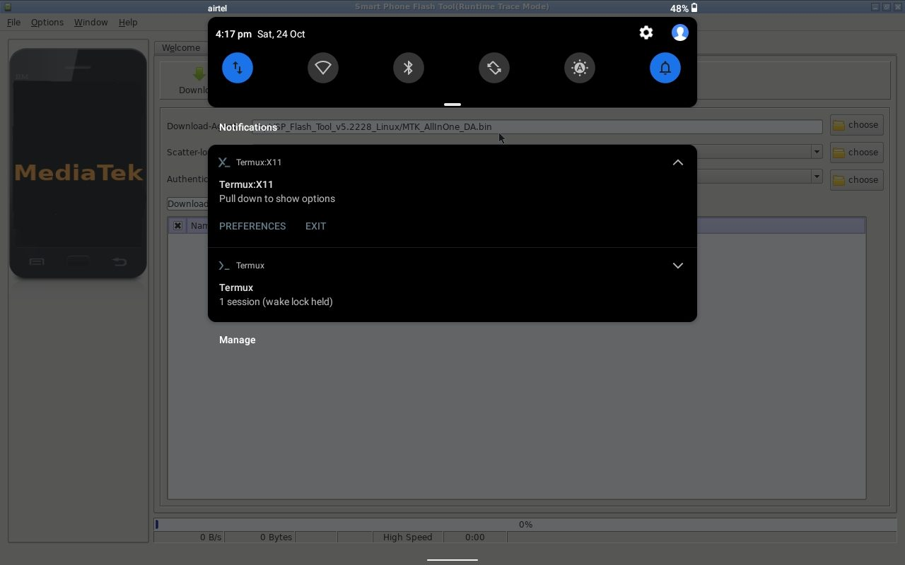
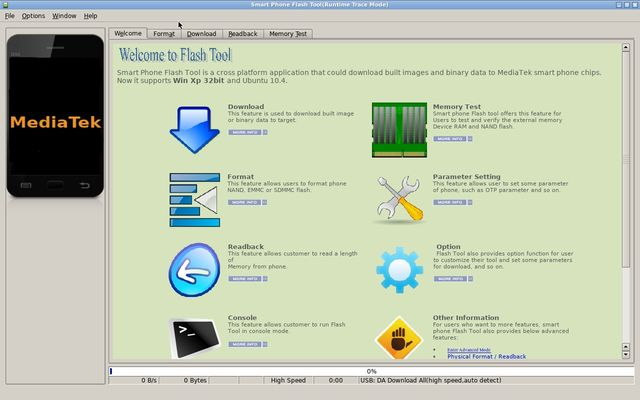
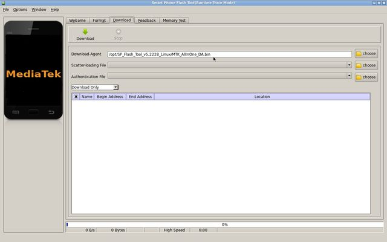
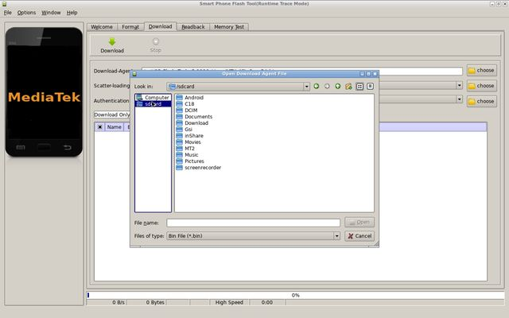
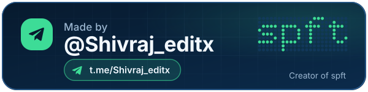

<p align="center">
  
</p>

<p align="center">
  <a href="docs/GUIDE.md#1-what-you-need"></a>
  <a href="docs/GUIDE.md#1-what-you-need"></a>
  <a href="docs/GUIDE.md#1-what-you-need"></a>
  <a href="docs/GUIDE.md#1-what-you-need"></a>
  <a href="LICENSE"></a>
</p>

<h3 align="center">Flash or unbrick a MediaTek phone or tablet<br>with just another rooted Android phone. No PC.</h3>

<p align="center">
  <a href="#start-in-3-steps"><b>Start</b></a> &nbsp;·&nbsp;
  <a href="#see-it-running">See it running</a> &nbsp;·&nbsp;
  <a href="#check-a-phone-first-no-install">Check your phone</a> &nbsp;·&nbsp;
  <a href="docs/GUIDE.md">Guide</a> &nbsp;·&nbsp;
  <a href="docs/TROUBLESHOOTING.md">Fix a problem</a> &nbsp;·&nbsp;
  <a href="docs/HOW-IT-WORKS.md">How it works</a>
</p>

<p align="center">
  <sub>Made by <b>Shivraj</b> &nbsp;·&nbsp; <a href="https://t.me/Shivraj_editx">Telegram @Shivraj_editx</a> &nbsp;·&nbsp; <a href="https://github.com/shivrajtode">GitHub</a></sub>
</p>

<br>

<table>
  <tr>
    <td width="33%" valign="top">
      <br>
      <b>Phone only</b><br>
      Your rooted phone is the computer. No PC, no Windows.
    </td>
    <td width="33%" valign="top">
      <br>
      <b>Smooth screen</b><br>
      The real SP Flash Tool on Termux:X11, not on a slow VNC. Its window fits your screen by itself.
    </td>
    <td width="33%" valign="top">
      <br>
      <b>Safe to try</b><br>
      <code>spft check</code> tests your phone first. <code>spft stop</code> stops everything and cleans up.
    </td>
  </tr>
</table>

## See it running

<p align="center">
  <a href="assets/screenshots/running-on-android.jpg"></a>
  <br><sub>No PC: this is the tablet's own screen. The status bar, the clock and the Termux and Termux:X11 notifications are Android's.</sub>
</p>

<table>
  <tr>
    <td width="33%" valign="top" align="center">
      <a href="assets/screenshots/welcome.jpg"></a><br>
      <sub><b>Fits the screen.</b> The Welcome tab, nothing cut off.</sub>
    </td>
    <td width="33%" valign="top" align="center">
      <a href="assets/screenshots/download-tab.jpg"></a><br>
      <sub><b>Ready to flash.</b> The Download tab, with its Download-Agent file already selected.</sub>
    </td>
    <td width="33%" valign="top" align="center">
      <a href="assets/screenshots/file-picker.jpg"></a><br>
      <sub><b>Sees your files.</b> The file window opens the phone's storage, <code>/sdcard</code>.</sub>
    </td>
  </tr>
</table>

## What you need

| The phone that runs spft (the host) | The device you want to fix (the target) |
|---|---|
| **Rooted** (Magisk, KernelSU, APatch) | A **MediaTek (MTK)** chip. Not Qualcomm, Exynos or Unisoc. |
| Android 8 or newer, with a **64-bit kernel** | The **exact firmware** for your model, unzipped, with a `..._scatter.txt` file |
| An **OTG adapter** and a **data** USB cable | Switched **off** when you connect it |
| About 3 GB free space, and internet for the install | A battery as full as you can get it |

Not sure about your phone? [Check it first](#check-a-phone-first-no-install). It installs nothing. All the details are in the [Guide](docs/GUIDE.md#1-what-you-need).

## Start in 3 steps

<p align="center">
  
</p>

### Step 1. Get the apps

Download them from these links, **not** from Google Play. Open each app once after you install it.

| App | What it is for | Get it |
|---|---|---|
| **Termux** | The terminal where you type `spft` | [F-Droid](https://f-droid.org/packages/com.termux/) or [GitHub](https://github.com/termux/termux-app/releases) |
| **Termux:X11** | The screen the tool is shown on | [GitHub nightly](https://github.com/termux/termux-x11/releases/tag/nightly): the file `termux-x11-universal-debug.apk` |
| **Termux:API** (optional) | Only for other Termux tools. spft works without it. | [F-Droid](https://f-droid.org/packages/com.termux.api/) or [GitHub](https://github.com/termux/termux-api/releases) |

> [!IMPORTANT]
> Termux and Termux:API must come from the **same place** (both F-Droid, or both GitHub). They are signed with different keys. More rules: [Guide, section 2](docs/GUIDE.md#2-install-the-apps).

### Step 2. Install spft (one time)

Open **Termux**, paste this one line and press Enter:

```
pkg update -y && pkg install -y git && git clone https://github.com/shivrajtode/spft ~/spft && bash ~/spft/install.sh
```

- At the very start your root app asks: press **Allow** for Termux, quickly. (KernelSU and APatch may show no window: switch Termux on in their *Superuser* list before you start.)
- The first time it downloads a few hundred MB. How long that takes depends on your internet: spft shows the speed and the time left, and it downloads four files at a time. Keep Termux open and the phone charging. A quiet screen is not a hang: [what you will see](docs/GUIDE.md#3-install-spft-one-time).
- Stopped half way, or the internet dropped? Run `bash ~/spft/install.sh` again. It only does what is still missing, and it carries on with the downloads where they stopped.

<details>
<summary>Why two commands, and not only <code>git clone</code>?</summary>

`git clone` only copies files. Git never runs a program from a repository (that would be unsafe), so the install is one more command, `install.sh`. The line above does both for you.

</details>

### Step 3. Start it

When the install says `done`, type:

```
spft
```

A small menu opens. **Start SP Flash Tool** is its first entry: pick it, and the tool opens on the Termux:X11 screen, fitted to your display. The menu also has the screen settings, stop, check, update, a shell in Debian, and a switch to open this menu every time you open Termux. Want to skip the menu? Type `spft start`. Next: [**flash your device without errors**](docs/GUIDE.md#6-flash-firmware-without-errors).

## Check a phone first (no install)

Can this phone be the host? Find out **without installing anything**. In Termux paste:

```
bash <(curl -fsSL https://raw.githubusercontent.com/shivrajtode/spft/main/check.sh)
```

It downloads a few small files into a temporary folder, tests the phone, and deletes them again. Your root app may ask: press **Allow** for Termux. (If it says `curl: command not found`, run `pkg install curl` first.)

<p align="center">
  
</p>

The check ends with a **Result**: whether spft can run on this device, and what to keep in mind. [More about the check, with the output of a tablet that cannot flash](docs/GUIDE.md#check-a-phone-first-no-install).

## How it works

<p align="center">
  
</p>

`spft` sets up all of this for you. **Termux** is where you type, **Debian** is a small Linux system inside your phone, **box64** lets it run SP Flash Tool (made for x86_64 PCs), and **Termux:X11** shows the tool's window. The details (folders, settings, tests) are in [How it works](docs/HOW-IT-WORKS.md).

## Everyday commands

| Command | What it does |
|---|---|
| `spft` | Open the menu. **Start SP Flash Tool** is its first entry. |
| `spft start` | Start SP Flash Tool at once, without the menu |
| `spft stop` | Force-stop everything of spft and clear the caches. Never while it flashes. |
| `spft check` | Test the phone and the setup, with a hint for every problem |
| `spft update` | Get the newest spft and apply it |
| `spft tool` | Install or change SP Flash Tool, for example when its download fails |
| `spft autostart on` | Open the menu every time you open Termux (`off` switches it off again) |
| `spft uninstall` | Delete the Debian system and the downloads. Asks first. |
| `spft help` | Show all commands |

All commands and screen options: [Guide](docs/GUIDE.md#all-commands).

## Need help?

<table>
  <tr>
    <td width="33%" valign="top">
      <a href="docs/GUIDE.md"></a><br>
      <b><a href="docs/GUIDE.md">Guide</a></b><br>
      Every step in order: your files, flashing without errors, Android 12 and newer.
    </td>
    <td width="33%" valign="top">
      <a href="docs/TROUBLESHOOTING.md"></a><br>
      <b><a href="docs/TROUBLESHOOTING.md">Fix a problem</a></b><br>
      Error codes (<code>1013</code>, <code>2005</code>, <code>5054</code>, ...), a black screen, a device that is not found.
    </td>
    <td width="33%" valign="top">
      <a href="docs/HOW-IT-WORKS.md"></a><br>
      <b><a href="docs/HOW-IT-WORKS.md">How it works</a></b><br>
      Folders, settings and tests, for the curious.
    </td>
  </tr>
</table>

Still stuck? Open an issue at <https://github.com/shivrajtode/spft/issues> and paste the output of `spft check`.

## Good to know

> [!WARNING]
> Flashing the wrong firmware, or interrupting a flash, can **permanently damage a device**. You use this at your own risk.

- **Tested** on a Samsung Galaxy J7 Max (Android 8, 32-bit Android on a 64-bit kernel) with SP Flash Tool v5.2228. The install, the commands and the download logic are also covered by automatic tests that use stand-in programs (`bash tests/run_all.sh`). Other devices should work if they meet the [requirements](docs/GUIDE.md#1-what-you-need). Please report what you find.
- Devices with **secure boot** (they ask for an *Auth* file, or report errors like `S_AUTH` or `STATUS_BROM_CMD_SEND_DA_FAIL`) usually cannot be flashed with SP Flash Tool alone. [mtkclient](https://github.com/bkerler/mtkclient) can work around this on many of them.
- SP Flash Tool belongs to MediaTek. It is **not part of this repository** and is downloaded when you install.

<br>

<div align="center">

And Special thanx💖 to my friend **Kaif** Telegram [@mkr_infinity](https://t.me/mkr_infinity) for recommending spflashtool linux version and giving some guide about it.

Thanks to [Termux](https://termux.dev/en/), [Termux:X11](https://github.com/termux/termux-x11), [box64](https://github.com/ptitSeb/box64), [Debian](https://www.debian.org), [mtkclient](https://github.com/bkerler/mtkclient), and the [Hovatek forum](https://www.hovatek.com/forum/post-228.html) for its SP Flash Tool guide and [error code list](https://www.hovatek.com/forum/post-93019.html).

<br>

<a href="https://t.me/Shivraj_editx"></a>&nbsp;<a href="https://t.me/Shivraj_editx"></a>

If spft saved you a trip to a PC, drop a ⭐ on the repo. It really helps!

<sub>MIT licensed (this repository only, not SP Flash Tool) · see <a href="LICENSE">LICENSE</a> · GitHub <a href="https://github.com/shivrajtode">shivrajtode</a></sub>

</div>
